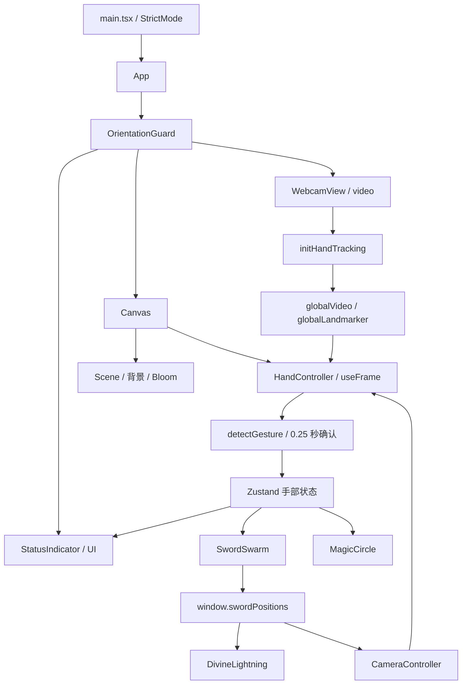

# 02 架构与手势识别

## 1. 组件与数据通路



相机参与手部位置投影，而相机又跟随剑群；这是一条反馈链。调整相机跟随强度、缩放或目标平面时，必须同时观察手指与剑群的位置关系。

`Scene` 挂载相机、飞剑、雷电、法阵、星空、灵气粒子和 Bloom；`HandController` 与 `Scene` 是 Canvas 内的兄弟组件。逻辑跨越 DOM 视频元素、R3F 帧循环和 Zustand，不能只根据 React 组件树理解全部依赖。

## 2. 摄像头与识别器生命周期

源码：`R/src/App.tsx:117`、`R/src/services/HandTrackingService.ts:10`。

初始化顺序：

1. `WebcamView` 挂载后将 `<video>` 交给 `initHandTracking`。
2. 服务缓存一个 `initPromise`，重复调用返回同一个 Promise。
3. 根据屏幕方向申请前置摄像头，横向期望 `640×480`，纵向期望 `480×640`。
4. 绑定 `srcObject`，等待视频数据就绪，尝试 `play()`。
5. 从 `/models/wasm` 获取运行时，加载 `/models/hand_landmarker.task`。
6. 创建 GPU delegate、VIDEO 模式、最多一只手的 `HandLandmarker`。
7. `HandController` 在帧循环中读取全局视频和识别器引用。

注意：

- 屏幕方向只在初始化时决定期望视频尺寸，后续旋转不会重新协商流。
- `play()` 失败只记录警告，源码未实现警告中提到的“等待用户交互后重试”。
- 初始化失败清空 `initPromise`，但组件没有自动重试循环或重试按钮。
- 模型失败发生在打开摄像头之后，catch 中没有停止已取得的流。
- 未见组件卸载时停止视频 tracks、关闭 landmarker 或清空全局引用的统一操作。
- 单例避免并行创建不等于生命周期完整：若以后更换视频节点，已完成的 Promise 会让新节点跳过绑定。

## 3. 状态模型

源码：`R/src/store.ts:40`。

| 状态 | 初始值 | 主要生产者 | 主要消费者 |
| --- | --- | --- | --- |
| `targetPosition` | `(0,0,0)` | HandController | 剑群、法阵 |
| `isTracking` | `false` | HandController | 剑群、特效、相机和 UI |
| `gestureMode` | `LOTUS` | HandController 的确认逻辑 | 剑群、特效、UI |
| `pathHistory` | 300 个原点 | updatePath、extendPath、剑群待机逻辑 | 游龙阵型 |
| `lastDirection` | 零向量 | updatePath | extendPath |

低频 UI 用 Zustand selector 订阅；高频渲染多用 `useHandStore.getState()` 读取，避免把每把剑的位置放入 React state。这适合当前小型视觉演示。

`pathHistory` 与 `lastDirection` 会原地修改，没有通过 Zustand `set` 发布新引用。当前剑群逐帧读取同一引用，因此能看到修改；未来如果用 selector 做轨迹 UI，不能假定它会因这些修改自动重渲染。

另一组状态不在 store 中：飞剑位置与速度在 `SwordSwarm` 的 refs 中；位置数组又挂到 `window.swordPositions`，供相机和雷电读取。此做法把运行时耦合到单个全局实例，多画布或多剑阵场景需要重构共享方式。

## 4. 手势分类的真实规则

源码：`R/src/services/HandTrackingService.ts:76`。

对三个关节点计算中间点夹角：

```text
v1 = p1 - p2
v2 = p3 - p2
angle = acos(dot(v1,v2) / (|v1|·|v2|)) × 180/π
伸直 = angle > 150°
```

拇指采用点 `1,2,3`；其他手指采用 `5,6,7`、`9,10,11`、`13,14,15`、`17,18,19`。各手指指尖 `4,8,12,16,20` 不参与伸直判定，食指尖 `8` 另用于游龙 / 大庚的位置输入。

以下按代码实际判断顺序排列：

| 优先级 | 条件 | 输出 |
| --- | --- | --- |
| 1 | 五指中伸直数量 ≤ 1 | `SHIELD` |
| 2 | 食指、小指伸直，中指、无名指弯曲，拇指不限 | `DAGENG` |
| 3 | 拇指、食指伸直，其余三指弯曲 | `DRAGON` |
| 4 | 食指、中指伸直，小指弯曲，拇指与无名指不限 | `DRAGON` |
| 5 | 食指、中指、无名指、小指均伸直，拇指不限 | `LOTUS` |
| 6 | 以上均未匹配 | `LOTUS` |

原说明把“食指伸出”列为游龙，但仅食指伸直时数量为 1，先命中护盾。正确触发游龙的已有规则是手枪手势或满足上述条件的双指手势。

合成关键点实测覆盖了全部 32 种伸直 / 弯曲组合，结果与该表一致。真实手部在不同视角下是否稳定落入对应组合，仍需摄像头实测。

数学防护也有缺口：当前没有对零长度向量作保护，没有把余弦值 clamp 到 `[-1,1]`，没有检查关键点数量。完全重合的 21 个点会产生 `NaN` 角度，最终作为五指均未伸直而输出护盾。

## 5. 250ms 确认与新视频帧去重

源码：`R/src/components/HandController.tsx:13`、`:28`、`:49`。

检测前要求识别器存在、视频存在且 `readyState === 4`。用模块级 `lastVideoTime` 排除同一视频帧的重复推理；这不是固定频率限流，推理频率仍受视频帧率和渲染循环影响。

手势确认分两层：

```text
本次瞬时分类
   ├─ 与 pendingGesture 不同 → 改候选、重新记时
   └─ 与候选相同，且持续 > 0.25 秒
           └─ 与 currentConfirmedGesture 不同 → 写入 store
```

位置输入始终按已经确认的手势选择，避免阵型已切换而输入锚点仍沿用上一种规则。

这里的“持续”并未严格要求中间每帧都追踪成功。无手时只写 `isTracking=false`，没有清除 pending 与开始时间；恢复追踪后的同一候选可能把丢失期间的时间也计入确认时长。

此外，视频未就绪时直接 return，没有超时将 `isTracking` 置 false。摄像头冻结时，UI 可能保留上一帧的追踪状态。

## 6. 从视频坐标到 3D 目标

源码：`R/src/components/HandController.tsx:71`。

输入锚点：

- 护盾与莲花：手腕 `0` 与中指根 `9` 的中点。
- 游龙与大庚：食指尖 `8`。

镜像和坐标反转：

```text
ndcX = (1 - x) × 2 - 1 = 1 - 2x
ndcY = 1 - 2y
```

将 `(ndcX,ndcY,0.5)` 反投影到世界坐标，构造从相机出发的射线，再与世界 `z=0` 平面求交：

```text
dir = normalize(unproject(ndc) - camera.position)
distance = -camera.position.z / dir.z
worldPos = camera.position + dir × distance
```

因此，手部关键点的 `z` 只参与夹角判定，不用于直接控制目标深度。目标始终落在世界 `z=0` 平面，剑阵自身再产生三维分布。

代码没有把视频的裁剪、留边或视频宽高比映射显式纳入计算；如果后续改成可见的 `object-fit: cover` 摄像头预览，需要一并校准，不能假定预览中指尖与投影位置自然重合。还应为 `dir.z` 接近 0 的情况增加保护。

## 7. 追踪丢失后的实际行为

`HandController` 保留最后一次 `gestureMode`。剑群则把目标中心改回原点，并每个渲染帧往历史头部填入原点。

| 保留的 gestureMode | 无手时实际位置分支 | 其他表现 |
| --- | --- | --- |
| LOTUS | 莲花 | 继续在原点附近展示莲花 |
| DRAGON | 游龙 | 头部回原点，轨迹逐渐被原点替换 |
| SHIELD | 游龙兜底 | 速度 / 转向等部分参数仍按 SHIELD 计算 |
| DAGENG | 游龙兜底 | 法阵淡出，雷电隐藏；主剑光环条件仍读取保留模式 |

所以源码注释“无手势时使用默认 LOTUS”没有覆盖实际行为。若希望统一待机，建议保留识别模式用于恢复，同时单独派生 `effectiveMode = isTracking ? confirmedMode : idleMode`，并让运动、缩放、光环、相机和 UI 共用它。
