# 手势示例与截图

页面右上角新增「手势示例」按钮，点击后可查看五种手势图解。弹窗支持关闭按钮、点击遮罩和 Esc 关闭，并在关闭后恢复按钮焦点。

手势图是按照当前源码识别规则绘制的 SVG 示意图；下方 PNG 是本地浏览器中实际截取的界面。阵型截图通过模拟手部关键点驱动实际控制器生成，没有使用真实摄像头拍摄手部。图示的掌心与手指形状用于帮助理解姿势，不代表实际识别关键点的位置。

## 五种手势

### 1. 双指剑诀 → 游龙随行

食指、中指伸直，其余手指弯曲。飞剑跟随食指指尖移动。

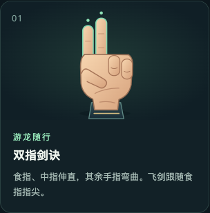

### 2. 手枪手势 → 游龙随行

拇指、食指伸直，中指、无名指和小指弯曲。与双指剑诀控制同一种游龙阵型。

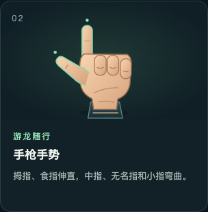

### 3. 张开手掌 → 莲花现世

自然张开手掌，四根长指伸直，掌心朝向摄像头。莲花阵型跟随手掌中心。

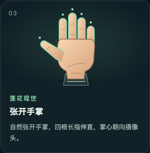

### 4. 握紧拳头 → 剑盾护体

五指收拢握拳。当前代码将伸直手指数量不超过一根的情况归入护盾，因此仅伸食指也会进入护盾。

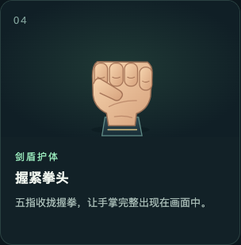

### 5. 摇滚手势 → 大庚剑阵

食指、小指伸直，中指、无名指弯曲。图中拇指自然收拢；代码对这个手势的拇指状态没有限制。

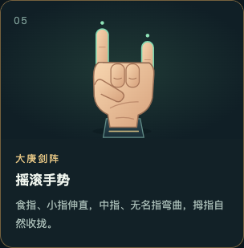

保持新手势约 0.3 秒，单手完整入镜，并保证光线充足，有助于稳定切换。

## 完整弹窗

桌面界面：

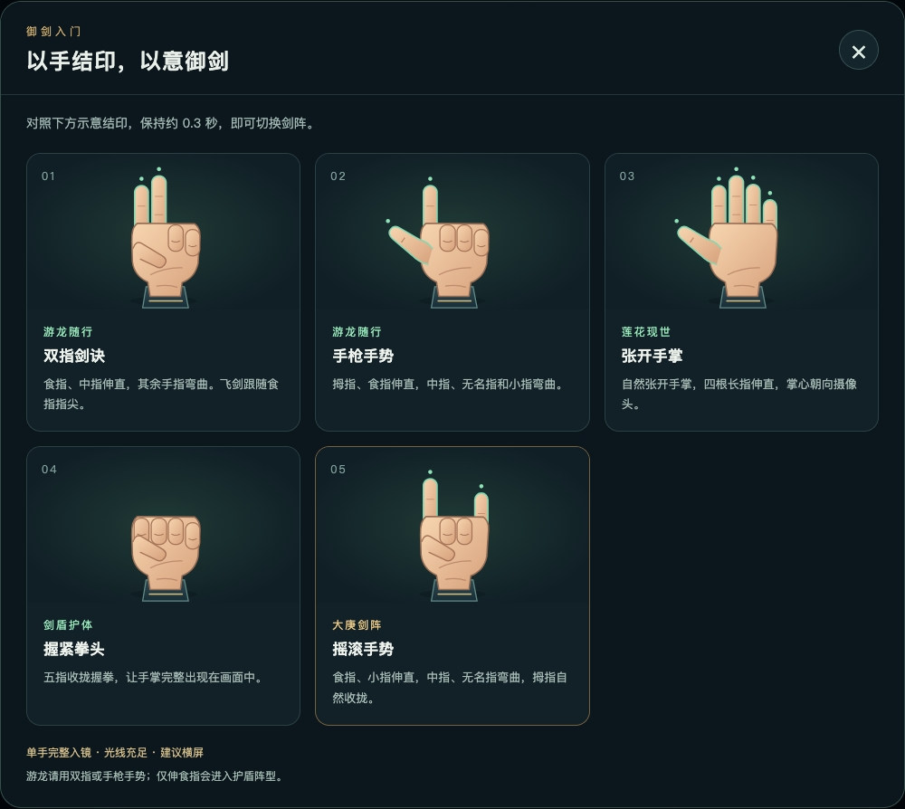

手机竖屏界面采用单列卡片，可上下滚动；顶部关闭按钮保持可见：

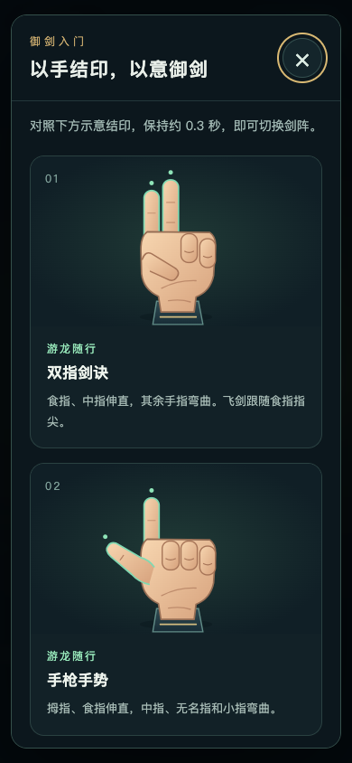

## 四种阵型效果

下列图片来自实际 Three.js 场景；测试通过输入模拟关键点确认对应手势，再等待阵型运动后截图。它们展示当前代码的效果，不代表真实手部识别准确率或所有设备上的性能。

### 游龙随行

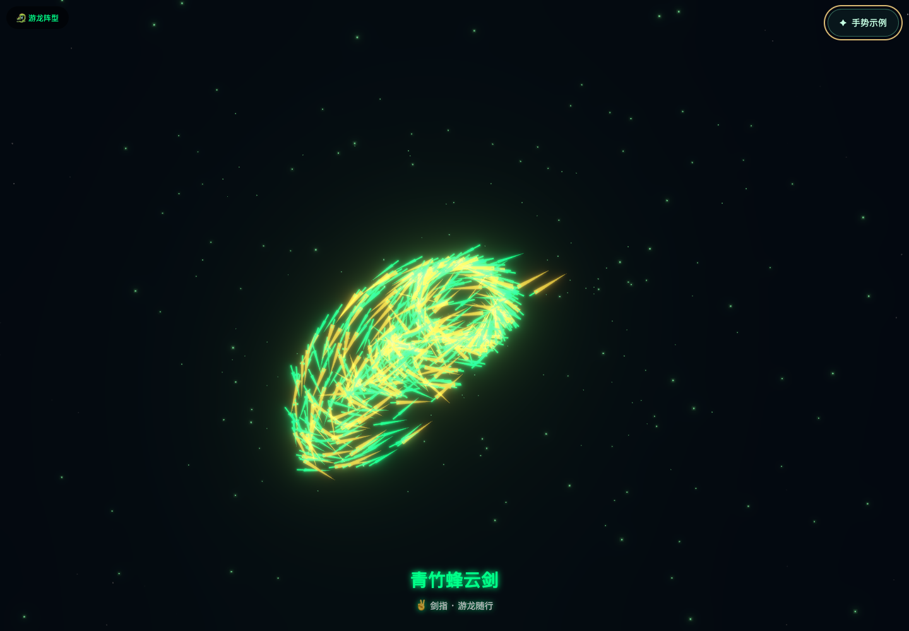

### 莲花现世

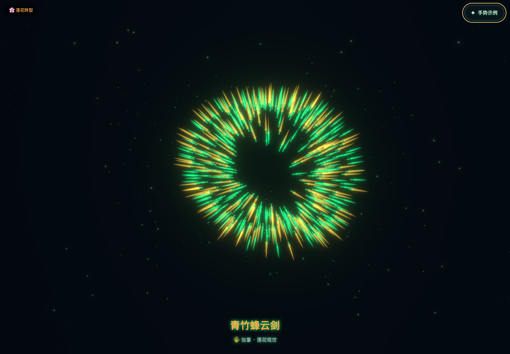

### 剑盾护体

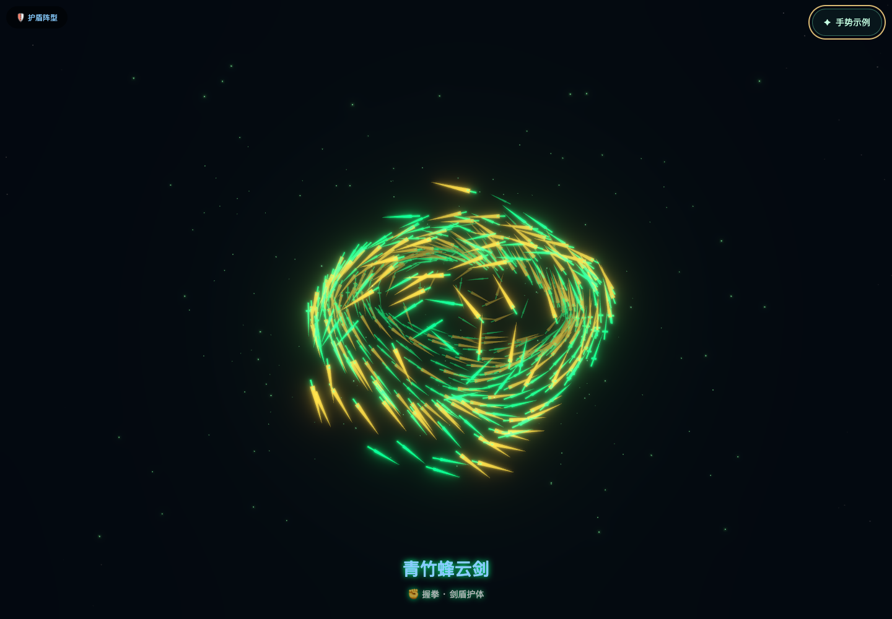

### 大庚剑阵

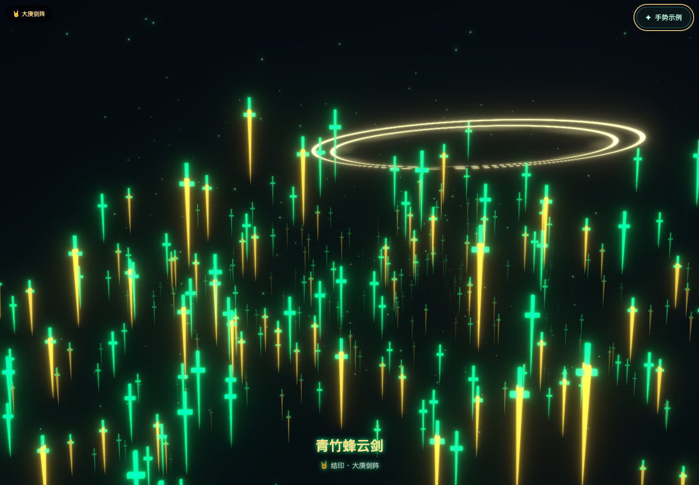

## 文件位置

| 内容 | 位置 |
| --- | --- |
| 示例弹窗和手势说明 | [GestureGuide.tsx](../React/src/components/GestureGuide.tsx) |
| 弹窗样式和响应式布局 | [GestureGuide.css](../React/src/components/GestureGuide.css) |
| 页面入口及按钮挂载 | [App.tsx](../React/src/App.tsx) |
| 手势 SVG 原图 | [React/public/gestures](../React/public/gestures) |
| 手势、弹窗和阵型 PNG 截图 | [doc/gestures](gestures) |
| 手势规则 | [HandTrackingService.ts](../React/src/services/HandTrackingService.ts) |

图解与界面文字按现有识别规则编写；图中双指剑诀选用其余手指全部弯曲的明确示范，识别器的完整判定条件见 [架构与手势识别](02-架构与手势识别.md)。

## 本次验证

- 生成 11 张 PNG：5 张手势卡片、桌面与手机弹窗各 1 张、4 张阵型效果。
- 桌面验证按钮打开、关闭按钮、遮罩关闭、Esc 关闭、关闭后焦点恢复和 Tab 焦点保持。
- 手机宽度 390px 下验证单列布局、无横向溢出、可滚动查看最后一张卡片，以及滚动后仍可使用顶部关闭按钮。
- 通过模拟关键点验证四种阵型状态和位置更新，浏览器未出现页面异常。
- TypeScript 检查与 Vite 生产构建通过；保留原项目已有的大包体积警告。

本次还修正了大庚状态标签缺失及两处提示乱码。历史问题清单中的其他算法与兼容性问题不在此次修改范围内。
